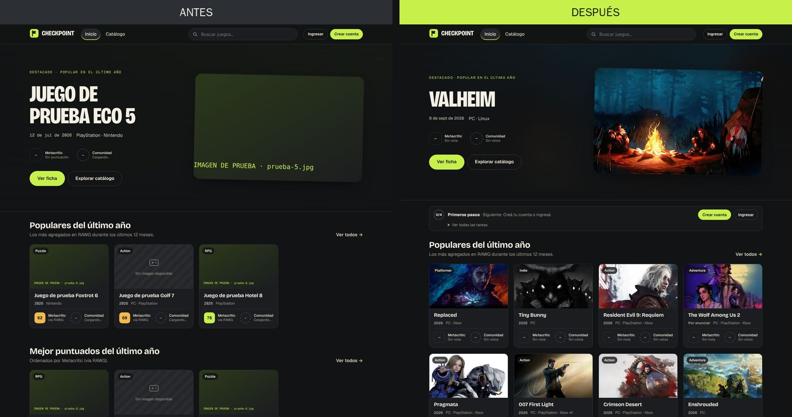
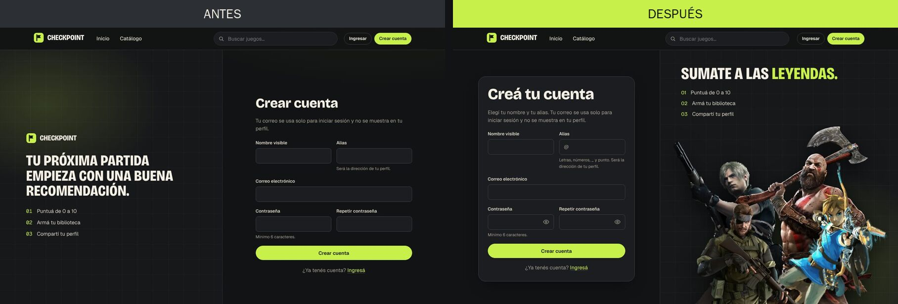
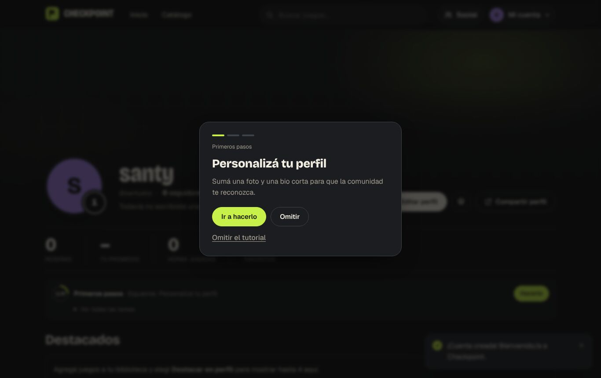
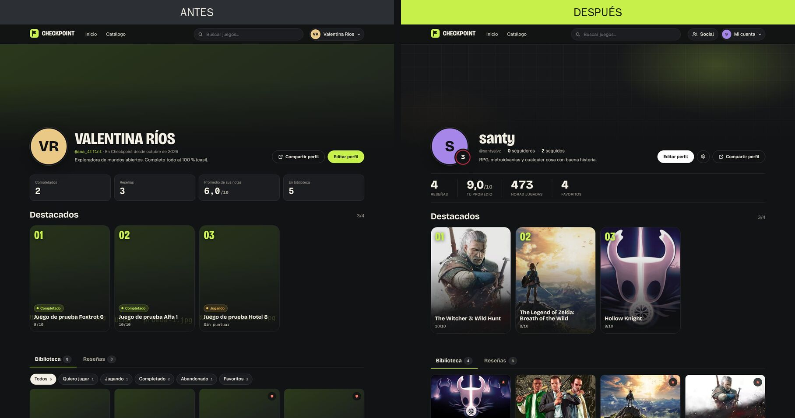
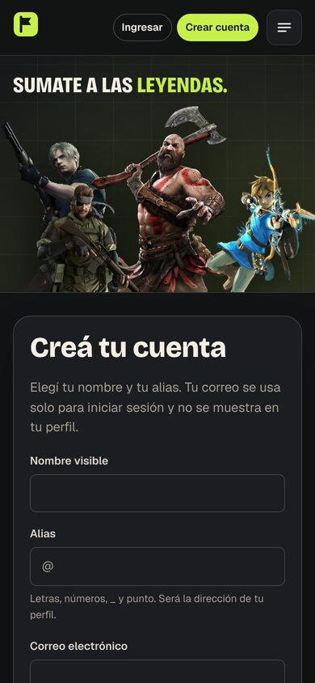
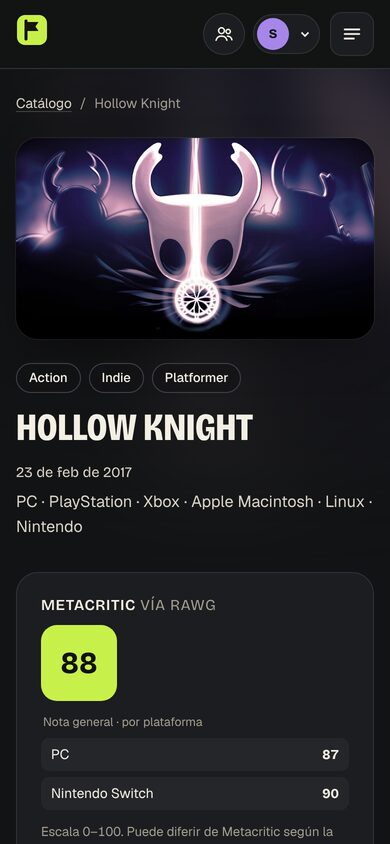
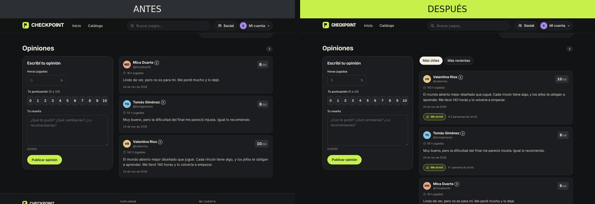
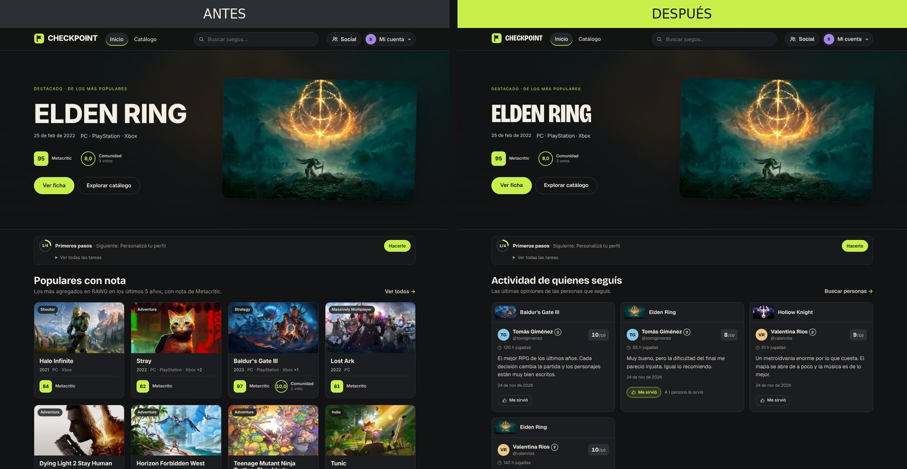
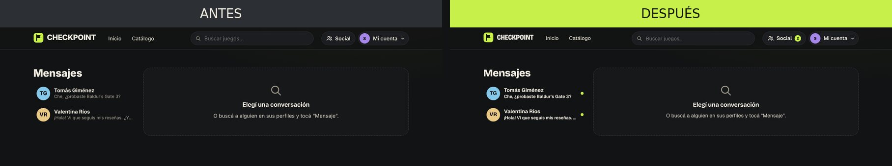
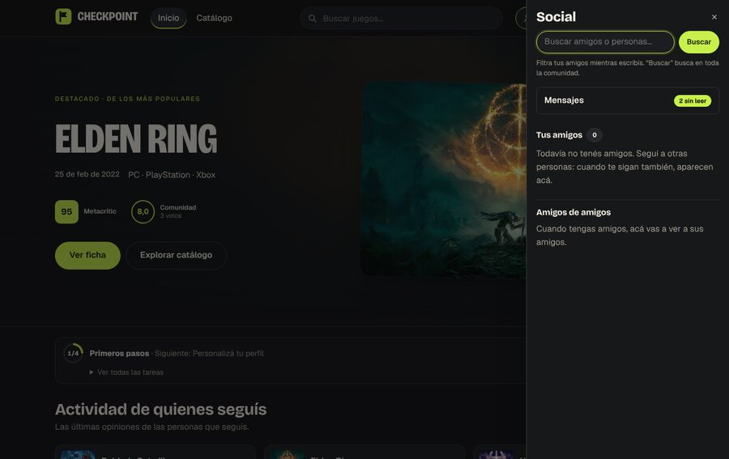

# Bitácora de Checkpoint

**TP2 · Desarrollo Frontend II**. Aplicación en React con IA, Firebase y despliegue en Vercel.

| | |
| --- | --- |
| Aplicación publicada | https://app-theta-ten-t7mx3z64op.vercel.app/ |
| Repositorio | https://github.com/ssntyalvarez/App |
| Informe | [docs/INFORME.md](INFORME.md) |

Esta bitácora registra los **cambios grandes** entre versiones, con capturas de antes y después. También cuenta cómo se probó cada versión, cómo se usó la IA y qué problemas aparecieron. El detalle de cada commit está en el historial de Git y en los pull requests del repositorio.

> **Sobre las capturas.** Las versiones 1 y 2 se capturaron con un catálogo de prueba (“Juego de prueba…”, “IMAGEN DE PRUEBA”) porque todavía no había clave de RAWG. Desde la versión 3 el catálogo es el real de RAWG. Las cuentas, reseñas y chats de las capturas finales son **cuentas de prueba** creadas en el emulador local de Firebase, no usuarios reales.

---

## Resumen de versiones

| Versión | Fecha | Qué cambió | Dónde |
| --- | --- | --- | --- |
| 0 · Plantilla | 20/10 | Proyecto creado con Vite (“Mi primer componente!”). | commit `a5fd910` |
| 1 · Primera versión funcional | 20/10 | Catálogo de RAWG, ficha de juego, cuentas y opiniones en Firestore, reglas de seguridad. | commits `d7cbc87`, `3d85a76` |
| 2 · Mejora de funciones | 20/10 | Perfiles públicos, biblioteca personal, favoritos y destacados. | commits `fe9727a`, `23b9821` |
| 3 · Refinamiento y publicación | 20/10 a 03/11 | Rediseño visual, datos reales de RAWG, proyecto real de Firebase y publicación en Vercel. | commits `65d2ce3` → `6d18c4f`, PR #2 |
| 4 · Versión final | 03/11 | Pantallas de acceso con personajes, opiniones estilo Steam, tutorial, parte social, chat, niveles y rediseño del perfil. | PR #3 → PR #9 |
| 5 · Mejoras para el final | 17/11 a 24/11 | Correcciones después de la demostración, “Me sirvió” en las reseñas, actividad de quienes seguís y mensajes sin leer. | PR #12 → PR #18 |

---

## Versión 0 · Punto de partida

El repositorio empezó con la plantilla de React + Vite. Lo primero fue preparar la base. Se instalaron las dependencias desde el lockfile, se verificaron `build` y `lint`, y se escribieron el README y la guía para la IA (`CLAUDE.md`).

---

## Versión 1 · Primera versión funcional

**Idea:** una web para descubrir videojuegos que muestre **dos notas separadas**, la de Metacritic y la de la comunidad de la app, y que cada persona pueda puntuar y opinar.

**Cambios principales**
- **Catálogo real con RAWG:** búsqueda con demora (hace una sola consulta cuando terminás de escribir), filtros por género, plataforma y año, orden y “Cargar más”.
- **Clave protegida:** la clave de RAWG nunca llega al navegador. Una función de servidor de Vercel (`api/rawg.js`) hace de intermediaria y solo acepta consultas permitidas.
- **Ficha de juego** con tres notas de formas distintas. Metacritic va en un cuadrado (0 a 100), la Comunidad Checkpoint en un círculo (0 a 10, con cantidad de votos) y aparte la nota personal.
- **Firebase:** registro e inicio de sesión con Authentication, y opiniones guardadas en Cloud Firestore. Se pueden crear, editar y eliminar, y hay una sola por persona y por juego.
- **Reglas de Firestore:** todos pueden leer las reseñas, pero solo el autor puede escribir la suya. Se validan la nota (entero de 0 a 10), el largo del texto y los campos permitidos.
- **Sin datos inventados:** si falta RAWG o Firebase, la app avisa que no está conectada en vez de mostrar datos de ejemplo.

**Pruebas:** 15 de la función de RAWG, 16 de reglas en el emulador de Firestore (por ejemplo, que otra persona no pueda editar ni borrar una reseña) y 11 de punta a punta con Playwright. Esas últimas crean, recargan, editan y eliminan una opinión, y calculan el promedio entre dos usuarios.

**Dificultades**
- *Dos copias de Firebase instaladas:* las pruebas fallaban con `this.getApp(...).firestore is not a function`. Con `npm ls` se encontró el problema y se resolvió dejando una sola versión.
- *Un filtro que volvía a aparecer después de limpiarlo:* lo detectó una prueba automática. La navegación leía la URL vieja, y se corrigió leyéndola en el momento del clic.

---

## Versión 2 · Mejora de funciones: perfiles y biblioteca

**Cambios principales**
- **Perfil público** en `/u/alias`, con avatar, biografía, estadísticas y botón para compartir.
- **Biblioteca personal** y **hasta 4 juegos destacados** en el perfil.
- **La nota personal sale de un solo lugar:** la biblioteca no guarda puntuación. La nota siempre sale de la reseña, así nunca hay dos valores distintos.
- **Avatar sin servicios pagos:** Firebase Storage pide el plan pago. Por eso la imagen se comprime en el navegador y se guarda dentro del perfil.

**Pruebas:** las reglas pasaron a 22 pruebas (solo el dueño modifica su perfil y su biblioteca, y nadie puede guardar el correo) y hubo 15 pruebas de punta a punta.

**Dificultad:** al tocar la biblioteca, el cambio tardaba en verse. Se agregó una *actualización optimista*. La interfaz cambia al instante y vuelve atrás si Firestore rechaza el cambio.

---

## Versión 3 · Refinamiento visual y publicación

**Cambios de diseño**
- Inicio con juego destacado y filas deslizables en celular. En celular, el registro tiene una franja con la marca.
- Auditoría automática de accesibilidad (WCAG 2.1 AA, contraste incluido) en seis pantallas.
- Las páginas se cargan cuando hacen falta. El paquete principal bajó de 1 MB a 44 kB.

**Conexión con los servicios reales**
- **RAWG con datos reales:** búsqueda, filtros, “Cargar más” y fichas probados contra la API.
- **Firebase real** (proyecto `mi-app-681e0`): un script con dos cuentas temporales probó el registro, crear, editar y eliminar, que los datos sigan al recargar y el promedio (7,5). También comprobó que las reglas no dejan editar opiniones ajenas.
- **Vercel:** Root Directory `my-react-app`. Cada cambio que llega a `main` se publica solo.

**Dificultades**
- *Imágenes rotas:* RAWG solo acepta algunos anchos de imagen redimensionada, y con 960 px devolvía error 404. Ahora se pide el ancho permitido más cercano y, si falla, la imagen original.
- *Índice de Firestore:* el promedio de la comunidad andaba en el emulador pero falló en el proyecto real (“The query requires an index”). Se declaró el índice y se agregó otra forma de calcular el promedio por si el índice no está.
- *RAWG caído (error 522):* la app se quedaba cargando para siempre. Ahora la consulta se corta a los 10 segundos y muestra “RAWG tardó demasiado en responder”.
- *Vercel no mostraba la app:* la app estaba en una rama de trabajo y `main` seguía con la plantilla. Se fusionó con un pull request, y desde ahí cada cambio en `main` se publica solo.
- *Reglas desactualizadas:* cada vez que cambiaron las reglas hubo que publicarlas de nuevo en Firebase, porque desplegar en Vercel no las actualiza.

---

## Versión 4 · Versión final, a partir de la revisión del diseño

Esta versión salió de revisar la app publicada pantalla por pantalla. La idea era sacar lo que se veía genérico o “hecho con IA”, ordenar la jerarquía visual y tomar como referencia productos reales como Steam, Twitter, Instagram y Twitch.

### Pantallas de acceso
- **Ingresar** (“¡Hola de nuevo!”): muestra un personaje de videojuego distinto en cada visita.
- **Crear cuenta:** tiene otra composición, con un póster de personajes. Las imágenes se recortaron con **rembg**, una IA de segmentación, porque recortar por color dejaba un borde blanco.
- **Formularios:** botón para ver u ocultar la contraseña. El alias lleva la “@” fija y sigue las reglas de Instagram (letras, números, guion bajo y punto).
- **Menos estética de IA:** se sacaron las píldoras y los rótulos decorativos, y también la tipografía monoespaciada (la del “0” tachado), que se veía genérica.

### Opiniones y biblioteca
- **Opiniones estilo Steam:** horas jugadas, nota de 0 a 10 y reseña escrita. Las tres son obligatorias.
- **La biblioteca son los juegos favoritos:** se sacaron los estados (Quiero jugar, Jugando, etc.) porque no hacían falta. Los favoritos se agregan con un corazón desde la ficha o desde la configuración.
- **Selector de año en dos pasos** (primero la década y después el año), en vez de una lista de 50 años.

### Primeros pasos
- **Tutorial:** al crear la cuenta aparece una pantalla por tarea (personalizar el perfil, agregar favoritos y opinar). “Ir a hacerlo” te lleva al lugar y lo marca con un borde que late y un cartel que dice “Tocá acá”.
- Si se omite, queda un recordatorio de **una sola línea** en el inicio y en el perfil. Al principio ocupaba mucho espacio y competía con la biblioteca.

### Parte social
- **Seguir:** si dos personas se siguen entre sí, son amigas.
- **Panel Social** desde el encabezado. Tiene la lista de amigos (con acceso al chat y al perfil), sugerencias de “amigos de amigos” y un buscador de personas.
- **Chat 1 a 1 en tiempo real** en ventanas flotantes, como en Twitch.
- **Configuración** con tres secciones. Perfil, Privacidad (quién puede escribirte, que puede ser cualquiera, amigos de amigos, solo amigos o nadie) y Cuenta (correo privado y cambio de contraseña). Las cuentas son siempre públicas.
- **Niveles y XP:** 100 XP por cada juego opinado y 50 más si la reseña es larga. Se calculan con las reseñas reales, así que no se pueden inflar. Se muestran como en Steam, con un anillo que cambia de color cada dos niveles, de gris a dorado.

| Panel Social | Chat flotante |
| --- | --- |
|  |  |

### Rediseño del perfil
La primera versión del perfil estaba muy cargada, con una tarjeta para cada dato y un bloque de nivel con mucho texto. En la versión final:
- El nombre va al lado de la foto. Debajo, en una línea, van `@alias · seguidores · seguidos`, como en Twitter. Cada contador abre su lista.
- El nivel es solo un número sobre el avatar. La barra y la XP aparecen al pasar el mouse.
- Los datos se muestran como una fila de números grandes, sin tarjetas.
- “Editar perfil” (botón blanco) quedó separado de la configuración de la cuenta (engranaje).

| Nivel al pasar el mouse | Perfil de otra persona | Lista de seguidores |
| --- | --- | --- |
|  |  |  |

### Celular

| Inicio | Registro | Perfil | Ficha |
| --- | --- | --- | --- |
|  |  |  |  |

### Pruebas de la versión final
| Prueba | Resultado |
| --- | --- |
| `npm run lint` y `npm run build` | Sin errores |
| `npm test` (función de RAWG, alias y niveles) | 34/34 |
| `npm run test:rules` (reglas en el emulador, con seguir, chat y “amigos de amigos”) | 32/32 |
| `npm run test:e2e` (Playwright con catálogo, opiniones, biblioteca, tutorial, seguir, chat entre dos navegadores, privacidad, niveles, accesibilidad y celular) | 26/26 |

### Dificultades de la versión final
- *Panel lateral de 68 px de alto:* el encabezado usa un efecto de desenfoque (`backdrop-filter`), y eso hace que los elementos fijos se ubiquen dentro del encabezado y no en la pantalla. Se resolvió montando el panel directamente en la página.
- *Página más ancha en celular:* el panel cerrado, escondido fuera de la pantalla, ensanchaba la página. Ahora el panel solo existe mientras está abierto.
- *Contadores en “…”:* en la versión publicada, las reglas eran de antes de la parte social, así que Firestore no dejaba leer los seguidores. Se publicaron de nuevo, y si hay un error ahora se muestra un guion en vez de quedarse cargando.
- *Menú tapado por el chat:* al sacar las capturas de esta bitácora se vio que la ventana de chat quedaba encima del menú “Mi cuenta”. Se cambió el orden de las capas.
- *Inicio con juegos “Sin nota”:* el destacado y la primera fila eran los juegos populares del último año, y ninguno tenía nota de Metacritic. Al consultar RAWG se vio que no tiene esa nota para ninguno de los 3.469 juegos del último año, porque dejó de cargarla alrededor de 2023. Ahora el inicio muestra los populares de los últimos 5 años que tienen nota (filtro `metacritic=1,100`) y no muestra “Comunidad · Sin votos” hasta que haya votos. La etiqueta dice solo “Metacritic”, y el crédito a RAWG sigue en el pie de página. En el catálogo y en la ficha se siguen viendo todos los juegos, tengan nota o no.
- *El chat no funcionaba en la demostración con el profesor:* al probarlo entre dos personas, los mensajes no llegaban o aparecía un error. Se reprodujo con dos navegadores a la vez y aparecieron tres fallas. Primero, si mandabas un mensaje mientras el anterior se seguía enviando, se perdía y se borraba lo escrito. Segundo, si los dos escribían el primer mensaje casi al mismo tiempo, el segundo intentaba crear de nuevo la conversación y Firestore lo rechazaba. Tercero, quien recibía no veía ningún aviso si no tenía ese chat abierto. Ahora los mensajes salen en cola y en orden, el segundo envío simultáneo se reintenta como un mensaje normal y, cuando llega un mensaje, se abre sola la ventana de esa conversación. Se agregó una prueba automática con los tres casos, que falla con el código anterior.

---

## Versión 5 · Mejoras para el final

Esta versión reúne todo lo que cambió **después de la entrega regular del 17/11**. No hubo correcciones pedidas por el profesor, así que el criterio fue otro. Primero se arregló lo que falló en la demostración. Después se sumaron tres funciones para que la parte social sirva para algo más que seguir y chatear.

### Correcciones después de la demostración (17/11)
- **Chat:** los mensajes no llegaban. Se reprodujo con dos navegadores, se encontraron tres fallas y se agregó una prueba automática (el detalle está en las dificultades de la versión 4).
- **Inicio solo con juegos con nota:** RAWG no tiene la nota de Metacritic de los juegos del último año, y el inicio se veía vacío.
- **Recuadro de “Tu nota personal”:** el texto “Sin puntuar” quedaba corrido hacia arriba.

### “Me sirvió” en las reseñas
Como en Steam, cada persona puede marcar como útil la reseña de otra. Hay un voto por persona y por reseña, y nadie puede votar la suya. Las opiniones de un juego se pueden ordenar por las más útiles o por las más recientes. El autor ve a cuántas personas les sirvió su reseña.

Los votos se guardan en una colección nueva de Firestore, `helpful`. Las reglas comprueban que la reseña exista, que el voto sea de quien lo manda y que no sea para una reseña propia.

### Actividad de quienes seguís
Antes, seguir a alguien no cambiaba nada en el inicio. Ahora aparece una sección con las últimas opiniones de las personas que seguís, arriba del catálogo. Si no seguís a nadie o todavía no opinaron, la sección no se muestra, para no dejar un bloque vacío.

### Mensajes sin leer
En la demostración, quien recibía un mensaje no se enteraba. Eso ya se había resuelto abriendo sola la ventana del chat, pero faltaba el caso de los mensajes que llegan cuando no estás conectado. Ahora el botón Social muestra cuántas conversaciones tenés sin leer. También se marcan en el panel Social y en la página de Mensajes. Al abrir la conversación queda leída, y eso se guarda en Firestore para que valga en cualquier dispositivo.

### Pruebas de la versión 5
| Prueba | Antes | Ahora |
| --- | --- | --- |
| `npm run lint` y `npm run build` | Sin errores | Sin errores |
| `npm test` (se suman mensajes sin leer y orden por “Me sirvió”) | 34/34 | 41/41 |
| `npm run test:rules` (se suman los votos y la marca de lectura) | 32/32 | 37/37 |
| `npm run test:e2e` (se suma `mejoras.spec.js`, con dos navegadores) | 26/26 | 28/28 |

### Dificultades de la versión 5
- *Límite de 30 valores en las consultas:* para traer las opiniones de la gente que seguís, o los votos de varias reseñas, Firestore usa el operador `in`, que acepta 30 valores como máximo. Las consultas se hacen de a tandas de 30 y el resultado se junta en el navegador.
- *Votos que quedaban sueltos:* si alguien borraba su reseña, los “Me sirvió” seguían en la base. Borrarlos solos desde el servidor necesita Cloud Functions, que es del plan pago. Se resolvió con una regla que deja al autor borrar los votos de su reseña, y la app los borra junto con ella.
- *Marcar como leído sin abrir permisos de más:* la regla del chat solo dejaba actualizar el último mensaje. Se agregó un segundo caso que permite a cada persona escribir únicamente su propia marca de lectura. Como en la entrega anterior las reglas publicadas quedaron viejas más de una vez, la lectura también se guarda en el dispositivo, así el aviso se apaga aunque las reglas nuevas todavía no estén publicadas.
- *Una prueba que pasaba sola y fallaba con las demás:* la prueba nueva usaba el mismo juego que otras, y encontraba reseñas de más porque el emulador comparte los datos. Ahora usa un juego propio.

---

## Uso de inteligencia artificial

**Herramienta:** Claude Code, el asistente de programación de Anthropic, trabajando sobre el repositorio de GitHub. Escribió el código, corrió las pruebas, sacó capturas de cada pantalla para revisarlas y subió cada cambio en una rama aparte, con un pull request antes de fusionarlo en `main`.

**Cómo se trabajó**
1. El autor definió la idea, el alcance y las decisiones de diseño, y revisó cada versión publicada.
2. La IA programó y probó cada cambio con pruebas automáticas (unitarias, de reglas en el emulador y en navegador) antes de entregarlo.
3. Las críticas del autor sobre cada resultado se convirtieron en cambios concretos. Gran parte de la versión 4 salió de esas revisiones.
4. Para la versión 5, el autor le pidió a la IA ideas de mejora para el final. La IA propuso tres funciones, y el autor decidió hacer las tres.

**Ejemplos representativos de instrucciones dadas a la IA**
- *Definición:* “Usá RAWG como fuente de datos… Protegé la clave de RAWG en una función de servidor compatible con Vercel. Limitá sus rutas y parámetros…”
- *Datos reales:* “No inventes puntuaciones, usuarios, reseñas ni cantidades de votos. La nota de usuarios de RAWG tampoco debe aparecer como si perteneciera a nuestra comunidad.”
- *Diseño:* “Esto es muy IA… agrandá a Leon… arreglá Kratos, que hay como un pico arriba a la izquierda.”
- *Modelo de datos:* “Si agregás un juego, lo ponés en tu biblioteca como favorito, no hace falta poner completado o no. Si hacés una opinión… como hace Steam: tiempo de juego, una puntuación y una descripción.”
- *Jerarquía visual:* “No me gustan muchas cosas de acá. Jerarquía no clara, hay mucho ruido en el nivel… no TODO se resuelve con cards… mirá cómo lo resuelven Twitter, Twitch, Instagram, que es MUY LIMPIO.”

**Instrucciones resumidas en lenguaje técnico y de diseño**

Son versiones cortas de instrucciones reales que se dieron durante el proyecto. Están reescritas para que sean breves y precisas, así que no son citas textuales.

| Área | Instrucción (resumida) |
| --- | --- |
| API | Proxy serverless en `api/rawg.js` con lista blanca de recursos y parámetros. `RAWG_API_KEY` solo en `process.env` y caché con `s-maxage`. |
| Seguridad | Reglas de Firestore con lectura pública de reseñas y escritura solo si `request.auth.uid` es el autor. Validar `score` entero de 0 a 10, largo de `text` y campos con `hasOnly`. |
| Modelo de datos | Reseña estilo Steam con `playtimeHours`, `score` y `text`. La biblioteca son favoritos, sin estados. |
| Identidad | Alias único estilo Instagram, con prefijo `@` y solo `[a-z0-9._]`. Unicidad con la colección `handles` y un cambio cada 7 días, validado en reglas. |
| Navegación | Header según la sesión. Sin sesión, *Ingresar* y *Crear cuenta*. Con sesión, menú de cuenta. Footer con todas las rutas. |
| Despliegue | Despliegue continuo. Cada cambio entra a `main` por pull request y Vercel hace el build solo. |
| Depuración | Reproducir el fallo del chat con dos clientes a la vez, encontrar la causa y agregar una prueba e2e de regresión. |
| Jerarquía visual | Perfil con menos ruido. Nivel solo como número, con tooltip al pasar el mouse, y métricas en una línea, no en cards. Referentes Twitter, Instagram y Twitch. |
| Estética | Nada de estética genérica de IA. Sin pills decorativas, sin tipografía monoespaciada y sin cards por defecto. |
| Composición | Hero de acceso con recortes limpios (sin halo), misma escala y encuadre entre personajes y sin cortes arbitrarios. |
| Contenido | Inicio solo con juegos que tengan nota de Metacritic. Ocultar estados vacíos como “Sin votos” en la vitrina. |
| Interacción | Chat como los susurros de Twitch, con ventanas flotantes, apilables y minimizables, sin salir de la página. |
| Mejoras para el final | Proponer mejoras para la instancia de final sobre lo ya entregado, y después implementar las tres propuestas con reglas, pruebas y documentación. |

**Revisión del código generado:** ningún cambio se publicó sin pasar lint, build y las pruebas automáticas. Varios errores reales los encontraron esas pruebas o las capturas, no la IA al escribir el código. Por ejemplo, el filtro que volvía a aparecer, el índice de Firestore, el panel de 68 px, el chat que tapaba el menú y los mensajes que no llegaban.

---

## Justificación del diseño final

- **Paleta:** fondo grafito y blanco cálido, para que las imágenes de los juegos sean lo principal. El verde lima se usa solo en las acciones principales, el foco del teclado y las notas altas.
- **Tipografía:** Bricolage Grotesque condensada y en mayúsculas para los títulos, que recuerda a una caja de videojuego, y Geist para el texto. La monoespaciada se descartó porque se veía genérica.
- **Una forma por tipo de nota:** cuadrado para Metacritic (0 a 100), círculo para la comunidad (0 a 10) y caja con borde para la nota personal. Se distinguen sin leer la etiqueta.
- **Perfil inspirado en Twitter e Instagram:** primero el nombre y la identidad, los datos como texto y no como tarjetas, y los detalles secundarios (XP y rango) al pasar el mouse.
- **Personajes de videojuegos** en las pantallas de acceso, para que la primera impresión sea la de un sitio para jugadores y no la de un formulario cualquiera.
- **Sin datos de relleno:** si falta un servicio, la app dice qué falta y no lo completa con datos de ejemplo.
