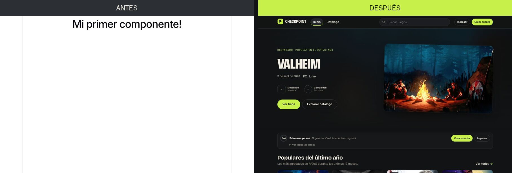
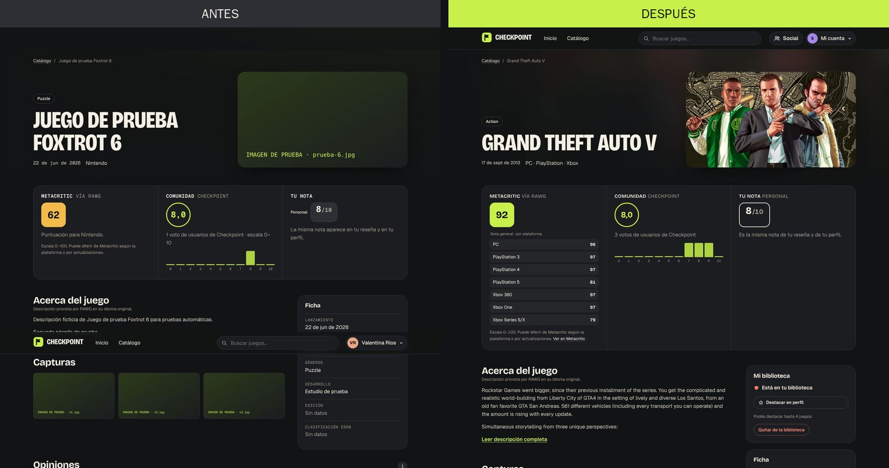
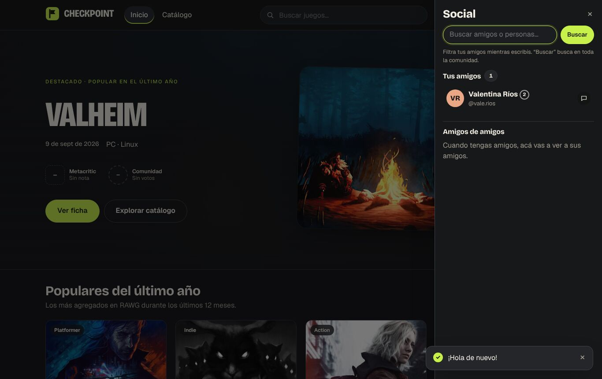
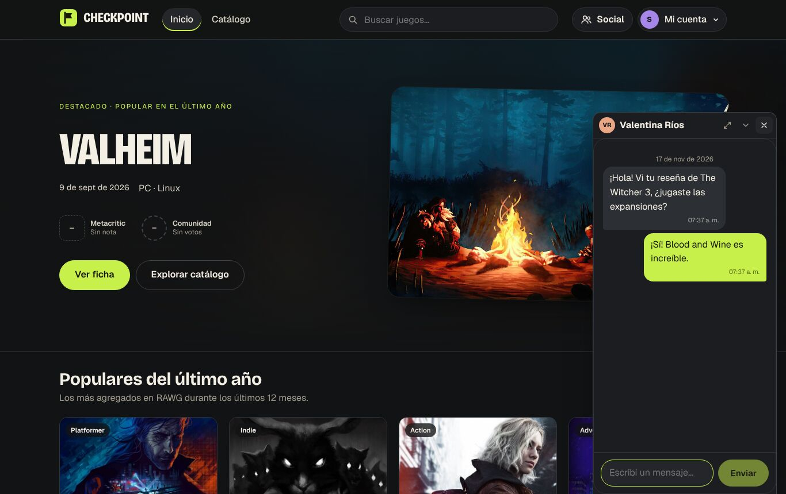
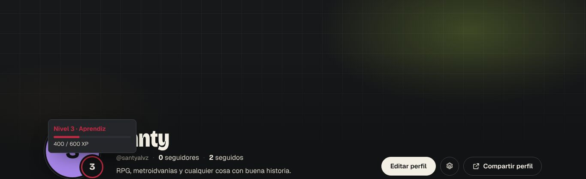
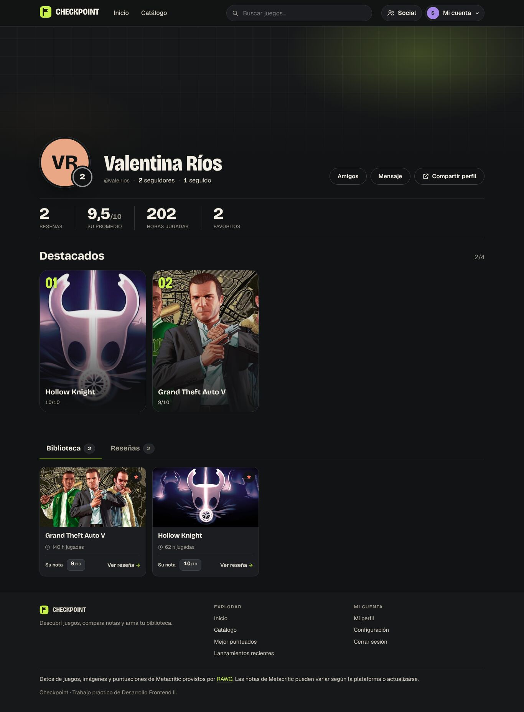
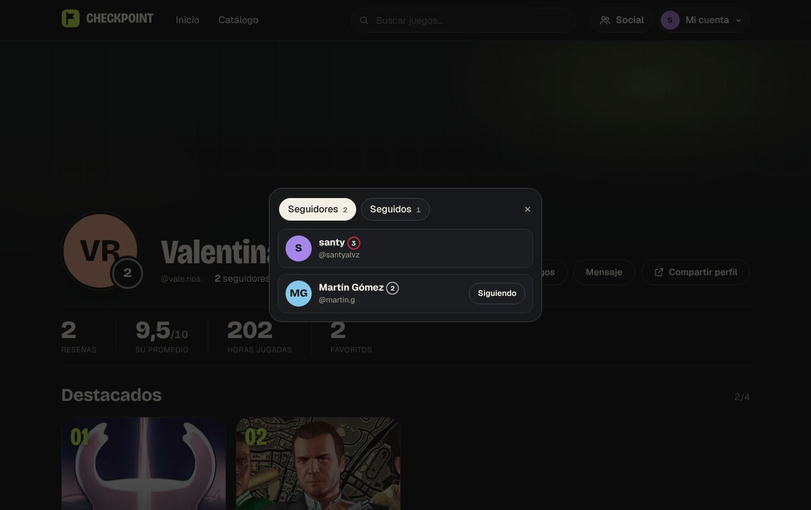
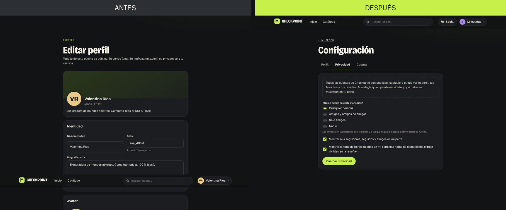
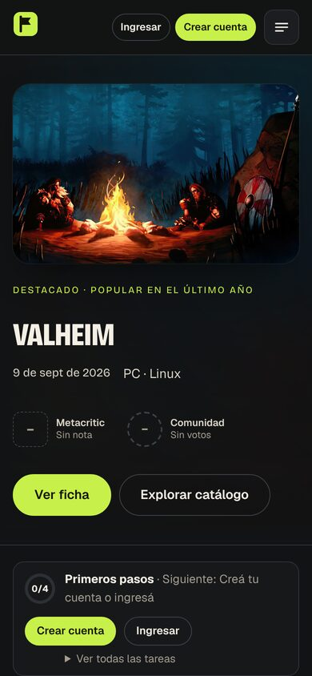
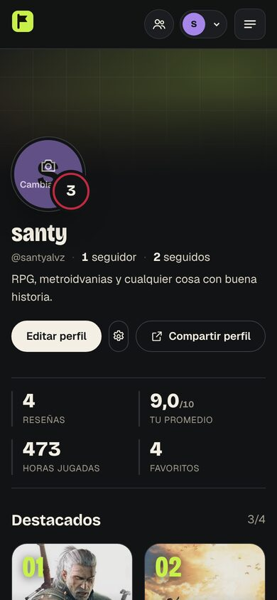

# Bitácora de Checkpoint

**TP2 · Desarrollo Frontend II** — Aplicación en React con IA, Firebase y despliegue en Vercel.

| | |
| --- | --- |
| Aplicación publicada | https://app-theta-ten-t7mx3z64op.vercel.app/ |
| Repositorio | https://github.com/ssntyalvarez/App |
| Informe | [docs/INFORME.md](INFORME.md) |

Esta bitácora registra solo los **cambios grandes** entre versiones, con capturas de antes y después, cómo se probó cada versión, cómo se usó la IA y qué dificultades aparecieron. El detalle commit a commit queda en el historial de Git y en los pull requests del repositorio.

> **Sobre las capturas.** Las versiones 1 y 2 se fotografiaron con un catálogo de prueba (“Juego de prueba…”, “IMAGEN DE PRUEBA”) porque todavía no había clave de RAWG. Desde la versión 3, el catálogo es el real de RAWG. Las cuentas, reseñas y chats que aparecen en las capturas finales son **cuentas de prueba** creadas en el emulador local de Firebase, no usuarios reales.

---

## Resumen de versiones

| Versión | Fecha | Qué cambió | Dónde |
| --- | --- | --- | --- |
| 0 · Plantilla | 20/10 | Proyecto creado con Vite (“Mi primer componente!”). | commit `a5fd910` |
| 1 · Primera versión funcional | 20/10 | Catálogo de RAWG, ficha de juego, cuentas y opiniones en Firestore, reglas de seguridad. | commits `d7cbc87`, `3d85a76` |
| 2 · Mejora de funciones | 20/10 | Perfiles públicos, biblioteca personal, favoritos y destacados. | commits `fe9727a`, `23b9821` |
| 3 · Refinamiento y publicación | 20/10 – 03/11 | Rediseño visual, datos reales de RAWG, proyecto real de Firebase y publicación en Vercel. | commits `65d2ce3` → `6d18c4f`, PR #2 |
| 4 · Versión final | 03/11 | Pantallas de acceso con personajes, opiniones estilo Steam, tutorial, parte social, chat, niveles y rediseño del perfil. | PR #3 → PR #9 |

---

## Versión 0 · Punto de partida

El repositorio arrancó con la plantilla de React + Vite. El primer paso fue preparar la base: instalar dependencias desde el lockfile, verificar `build` y `lint`, y escribir el README y la guía para la IA (`CLAUDE.md`).

---

## Versión 1 · Primera versión funcional

**Idea:** una web para descubrir videojuegos que muestre **dos notas separadas** (la de Metacritic y la de la comunidad de la app) y deje que cada persona puntúe y opine.

**Cambios principales**
- **Catálogo real con RAWG:** búsqueda con demora (una sola consulta al terminar de escribir), filtros por género, plataforma y año, orden y “Cargar más”.
- **Clave protegida:** la clave de RAWG nunca llega al navegador. Una función de servidor de Vercel (`api/rawg.js`) hace de intermediaria y solo acepta consultas permitidas.
- **Ficha de juego** con tres notas de formas distintas: Metacritic (cuadrado, 0–100), Comunidad Checkpoint (círculo, 0–10, con cantidad de votos) y nota personal.
- **Firebase:** registro e inicio de sesión (Authentication) y opiniones guardadas en Cloud Firestore. Se pueden crear, editar y eliminar, con una por persona y juego.
- **Reglas de Firestore:** todos pueden leer las reseñas, pero solo el autor puede escribir la suya; se validan la nota (entero de 0 a 10), el largo del texto y los campos permitidos.
- **Estados honestos:** si falta RAWG o Firebase, la app lo dice (“sin conectar”) y no muestra datos inventados.

**Pruebas:** 15 de la función de RAWG, 16 de reglas en el emulador de Firestore (incluida “otra persona no puede editar ni borrar”) y 11 de punta a punta con Playwright: crear, recargar, editar y eliminar una opinión, y promedio entre dos usuarios.

**Dificultades**
- *Dos copias de Firebase instaladas:* las pruebas fallaban con `this.getApp(...).firestore is not a function`. Se diagnosticó con `npm ls` y se resolvió fijando una sola versión.
- *Un filtro que “reaparecía” después de limpiarlo:* lo detectó una prueba automática. Era un problema de tiempos de la navegación y se corrigió leyendo la URL en el momento del clic.

---

## Versión 2 · Mejora de funciones: perfiles y biblioteca

**Cambios principales**
- **Perfil público** en `/u/alias`, con avatar, biografía, estadísticas y botón para compartir.
- **Biblioteca personal** y **hasta 4 juegos destacados** en el perfil.
- **Una sola fuente para la nota personal:** la biblioteca no guarda puntuación; la nota sale siempre de la reseña, así nunca hay dos valores contradictorios.
- **Avatar sin servicios pagos:** Firebase Storage requiere el plan pago, así que la imagen se comprime en el navegador y se guarda dentro del perfil.

**Pruebas:** reglas ampliadas a 22 (solo el dueño modifica su perfil y su biblioteca, nadie puede guardar el correo) y 15 pruebas de punta a punta.

**Dificultad:** el estado de la biblioteca tardaba en reflejarse al tocarlo. Se agregó *actualización optimista*: la interfaz cambia al instante y se revierte si Firestore rechaza el cambio.

---

## Versión 3 · Refinamiento visual y publicación

**Cambios de diseño**
- Inicio con juego destacado y carriles deslizables en celular; registro con franja de marca en celular.
- Auditoría automática de accesibilidad (WCAG 2.1 AA, incluido el contraste) en seis pantallas.
- Carga diferida de páginas: el paquete principal bajó de 1 MB a 44 kB.

**Conexión con los servicios reales**
- **RAWG con datos reales:** búsqueda, filtros, “Cargar más” y fichas verificados contra la API.
- **Firebase real** (proyecto `mi-app-681e0`): un script con dos cuentas temporales comprobó registro, crear/editar/eliminar, persistencia al recargar, promedio 7,5 y que las reglas rechazan editar opiniones ajenas.
- **Vercel:** Root Directory `my-react-app`. Cada cambio que llega a `main` se publica solo.

**Dificultades**
- *Imágenes rotas:* RAWG solo acepta algunos anchos de imagen redimensionada (960 px daba error 404). Se usa el ancho permitido más cercano y, si falla, la imagen original.
- *Índice de Firestore:* el promedio de la comunidad funcionaba en el emulador pero falló en el proyecto real (“The query requires an index”). Se declaró el índice y se agregó un cálculo alternativo mientras no exista.
- *RAWG caído (error 522):* la app quedaba “cargando” para siempre. Ahora la consulta corta a los 10 segundos y muestra “RAWG tardó demasiado en responder”.
- *Vercel no mostraba la app:* la app estaba en una rama de trabajo y `main` seguía teniendo la plantilla. Se fusionó con un pull request, y desde entonces cada cambio en `main` se publica automáticamente.
- *Reglas desactualizadas:* cada vez que cambiaron las reglas hubo que volver a publicarlas en Firebase, porque desplegar en Vercel no las actualiza.

---

## Versión 4 · Versión final, guiada por la revisión del diseño

Esta versión salió de revisar la app publicada con ojo crítico, pantalla por pantalla. Los criterios: menos “estética de IA”, jerarquía visual clara y referencias de productos reales (Steam, Twitter, Instagram y Twitch).

### Pantallas de acceso
- **Ingresar** (“¡Hola de nuevo!”): un personaje de videojuego que cambia en cada visita.
- **Crear cuenta:** composición distinta, con un póster de personajes. Las imágenes se recortaron con **rembg**, una IA de segmentación, porque el recorte por color dejaba un borde blanco.
- **Formularios:** botón para mostrar u ocultar la contraseña y alias con “@” fija y las reglas de Instagram (letras, números, guion bajo y punto).
- **Menos “estética de IA”:** se quitaron píldoras y rótulos decorativos, y la tipografía monoespaciada (“0” tachado) que el autor consideró genérica.

### Opiniones y biblioteca
- **Opiniones estilo Steam:** horas jugadas, nota de 0 a 10 y reseña escrita, las tres obligatorias.
- **Biblioteca = juegos favoritos:** se quitaron los estados (Quiero jugar, Jugando, etc.) por resultar innecesarios. Se agregan con un corazón desde la ficha o desde la configuración.
- **Selector de año en dos pasos** (década → año), en lugar de una lista de 50 años.

### Primeros pasos
- **Tutorial:** al crear la cuenta, una pantalla por tarea (personalizar perfil, agregar favoritos, opinar). “Ir a hacerlo” lleva al lugar y lo marca con un borde que late y un cartel “Tocá acá”.
- Si se omite, queda un recordatorio de **una sola línea** en el inicio y en el perfil. En una primera versión ocupaba demasiado espacio y competía con la biblioteca.

### Parte social
- **Seguir:** si dos personas se siguen mutuamente, son amigas.
- **Panel Social** desde el encabezado: lista de amigos con acceso al chat y al perfil, sugerencias de “amigos de amigos” y buscador de personas.
- **Chat 1 a 1 en tiempo real** en ventanas flotantes, como en Twitch.
- **Configuración** con tres secciones: Perfil, Privacidad (quién puede escribirte: cualquiera, amigos de amigos, solo amigos o nadie) y Cuenta (correo privado y cambio de contraseña). Las cuentas son siempre públicas.
- **Niveles y XP:** 100 XP por cada juego opinado, +50 si la reseña es detallada. Se calculan con las reseñas reales, así que no se pueden inflar. Se muestran como en Steam: un anillo cuyo color cambia cada dos niveles, de gris a dorado.

| Panel Social | Chat flotante |
| --- | --- |
|  |  |

### Rediseño del perfil
La primera versión del perfil tenía demasiado ruido: tarjetas para cada dato y un bloque de nivel con mucho texto. En la versión final:
- El nombre va al lado de la foto, y debajo, en una línea, `@alias · seguidores · seguidos` (como Twitter). Cada contador abre su lista.
- El nivel es solo un número sobre el avatar; el detalle con barra y XP aparece al pasar el mouse.
- Los datos se muestran como una franja de números grandes, sin tarjetas.
- “Editar perfil” (botón blanco) se separó de la configuración de la cuenta (engranaje).

| Nivel al pasar el mouse | Perfil de otra persona | Lista de seguidores |
| --- | --- | --- |
|  |  |  |

### Celular

| Inicio | Registro | Perfil | Ficha |
| --- | --- | --- | --- |
|  |  |  |  |

### Pruebas de la versión final
| Prueba | Resultado |
| --- | --- |
| `npm run lint` / `npm run build` | Sin errores |
| `npm test` — función de RAWG, alias, niveles | 34/34 |
| `npm run test:rules` — reglas en el emulador (incluye seguir, chat y “amigos de amigos”) | 32/32 |
| `npm run test:e2e` — Playwright: catálogo, opiniones, biblioteca, tutorial, seguir, chat entre dos navegadores, privacidad, niveles, accesibilidad y celular | 25/25 |

### Dificultades de la versión final
- *Panel lateral de 68 px de alto:* el encabezado usa un efecto de desenfoque (`backdrop-filter`), que hace que los elementos “fijos” se ubiquen dentro del encabezado en lugar de la pantalla. Se resolvió montando el panel directamente en la página.
- *Página achicada en celular:* el panel cerrado, escondido fuera de la pantalla, ensanchaba la página. Ahora el panel solo existe mientras está abierto.
- *Contadores en “…”:* en la versión publicada, las reglas eran anteriores a la parte social, así que Firestore rechazaba leer los seguidores. Se republicaron, y ahora un error se muestra como “—” en lugar de cargar sin fin.
- *Menú tapado por el chat:* al sacar las capturas de esta bitácora apareció que la ventana de chat flotante quedaba encima del menú “Mi cuenta”. Se corrigió el orden de capas.

---

## Uso de inteligencia artificial

**Herramienta:** Claude Code (asistente de programación de Anthropic) trabajando sobre el repositorio de GitHub. Escribió el código, ejecutó las pruebas, sacó capturas de cada pantalla para revisarlas y subió cada cambio en una rama separada, con un pull request antes de fusionar en `main`.

**Cómo se trabajó**
1. El autor definió la idea, el alcance y las decisiones de diseño, y revisó cada versión publicada.
2. La IA implementó y verificó con pruebas automáticas (unitarias, reglas en el emulador y navegador real) antes de cada entrega.
3. Las críticas del autor sobre el resultado se convirtieron en cambios concretos. Gran parte de la versión 4 salió de esa revisión.

**Ejemplos representativos de instrucciones dadas a la IA**
- *Definición:* “Usá RAWG como fuente de datos… Protegé la clave de RAWG en una función de servidor compatible con Vercel. Limitá sus rutas y parámetros; evitá convertirla en un proxy abierto.”
- *Honestidad de los datos:* “No inventes puntuaciones, usuarios, reseñas ni cantidades de votos. La nota de usuarios de RAWG tampoco debe aparecer como si perteneciera a nuestra comunidad.”
- *Diseño:* “Esto es muy IA… agrandá a Leon… arreglá Kratos, que hay como un pico arriba a la izquierda.”
- *Modelo de datos:* “Si agregás un juego, lo ponés en tu biblioteca como favorito, no hace falta poner completado o no. Si hacés una opinión… como hace Steam: tiempo de juego, una puntuación y una descripción.”
- *Jerarquía visual:* “No me gustan muchas cosas de acá. Jerarquía no clara, hay mucho ruido en el nivel… no TODO se resuelve con cards… mirá cómo lo resuelven Twitter, Twitch, Instagram, que es MUY LIMPIO.”

**Revisión del código generado:** ningún cambio se publicó sin pasar lint, build y las pruebas automáticas. Varios errores reales los encontraron esas pruebas o las capturas, no la IA al escribir el código: el filtro que reaparecía, el índice de Firestore, el panel de 68 px y el chat tapando el menú.

---

## Justificación del diseño final

- **Paleta:** fondo grafito y blanco cálido para que las imágenes de los juegos sean protagonistas. El verde lima se reserva para acciones principales, foco del teclado y notas altas.
- **Tipografía:** Bricolage Grotesque condensada en mayúsculas para los títulos (aire de “caja de videojuego”) y Geist para leer. Se descartó la monoespaciada por genérica.
- **Una forma por tipo de nota:** cuadrado para Metacritic (0–100), círculo para la comunidad (0–10) y caja con borde para la nota personal. Se distinguen sin leer la etiqueta.
- **Jerarquía del perfil** inspirada en Twitter e Instagram: nombre e identidad primero, datos como texto y no como tarjetas, y detalles secundarios (XP, rango) disponibles al pasar el mouse en lugar de a la vista.
- **Personajes de videojuegos** en las pantallas de acceso, para que la primera impresión sea de “sitio de jugadores” y no de formulario genérico.
- **Estados honestos:** cuando falta un servicio se dice qué falta; nunca se completa con datos de ejemplo.
