# Bitácora de Checkpoint

Registro del desarrollo por iteraciones: qué cambió, cómo se verificó y qué dificultades aparecieron.
Las capturas de `docs/evidencias/` las genera la prueba `e2e/evidencias.spec.js` contra los **emuladores de Firebase** y un **doble de prueba de RAWG con juegos ficticios** (“Juego de prueba …”, imágenes rotuladas “IMAGEN DE PRUEBA”). No son datos reales de RAWG ni de Metacritic: se usan porque durante el desarrollo no había una clave de RAWG ni un proyecto de Firebase configurados.

## Idea y público

- **Necesidad:** decidir qué jugar comparando la crítica (Metacritic) con la opinión de otros jugadores, y llevar registro de lo que uno juega.
- **Público:** jugadores que buscan recomendaciones y quieren una página personal para compartir sus gustos.
- **Datos en Firebase:** perfiles públicos (`users`), alias únicos (`handles`), opiniones (`reviews`) y, desde la iteración 2, bibliotecas personales.
- **Datos externos:** catálogo, imágenes y notas de Metacritic de RAWG, consultados a demanda mediante una función de servidor.

---

## Iteración 1 — Primera versión funcional

**Fecha:** 20/10/2026 · **Commits:** `d7cbc87` (primer avance visible) y el cierre de la iteración 1.

### Cambios
- Se reemplazó la pantalla de ejemplo de la plantilla (`MiPrimerComponente`, `App.css` y sus imágenes) por la estructura de Checkpoint: rutas con React Router, caché de consultas con React Query y fuentes autoalojadas (Bricolage Grotesque, Geist y Geist Mono).
- **Proxy de RAWG** (`api/rawg.js` + `api/_lib/rawg.js`): función de Vercel con lista blanca de recursos y parámetros, recorte de campos (descarta la nota de usuarios de RAWG para no confundirla con la comunidad), caché en memoria y `Cache-Control` para el CDN. El mismo código atiende `/api/rawg` en `npm run dev`.
- **Catálogo:** búsqueda con demora de 450 ms, filtros (género, plataforma, año), orden (relevancia, Metacritic, lanzamiento) y “Cargar más”. Los filtros viven en la URL, así que se pueden compartir.
- **Ficha:** imagen protagonista, panel con tres puntuaciones separadas (Metacritic con su plataforma, Comunidad Checkpoint con distribución de votos, nota personal), descripción, capturas con visor accesible y ficha técnica.
- **Cuentas y opiniones:** registro, ingreso y cierre de sesión con Firebase Auth; opiniones en `reviews/{gameId}_{uid}` (una por usuario y juego); crear, editar y eliminar; 0 es una puntuación válida; promedio calculado a partir de las opiniones reales.
- **Reglas de Firestore:** lectura pública de reseñas y perfiles; escritura solo del dueño; validación de puntuación entera 0–10, comentario ≤ 2000 caracteres y lista cerrada de campos; correo nunca guardado en Firestore.
- **Estados:** carga (esqueletos y spinners), vacío, error con reintento y “pendiente de conexión” cuando falta RAWG o Firebase.

### Pruebas realizadas
| Prueba | Resultado |
| --- | --- |
| `npm run lint` | Sin errores ni advertencias |
| `npm run build` | Correcto (aviso de chunk > 500 kB, a resolver en la iteración 3) |
| `npm test` — 15 pruebas del proxy (parámetros rechazados, clave ausente, la clave no se filtra, errores de RAWG) | 15/15 |
| `npm run test:rules` — 16 pruebas de reglas en el emulador (incluye “otro usuario no puede editar ni borrar”) | 16/16 |
| `npm run test:e2e` — 11 pruebas Playwright: búsqueda con una sola consulta, filtros, cargar más, estados vacíos, navegación, crear/recargar/editar/eliminar opinión, dos usuarios y promedio 7,5, validaciones, alias único, celular | 11/11 |

### Evidencias
| Inicio | Ficha con opinión publicada | Catálogo en celular |
| --- | --- | --- |
| 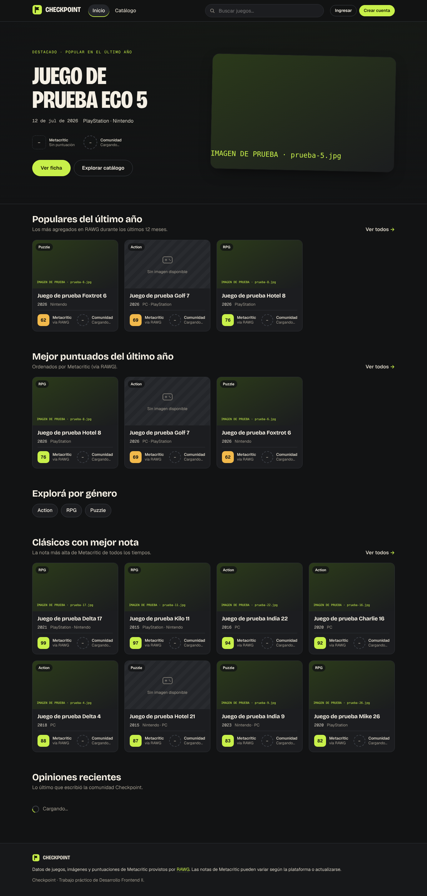 | 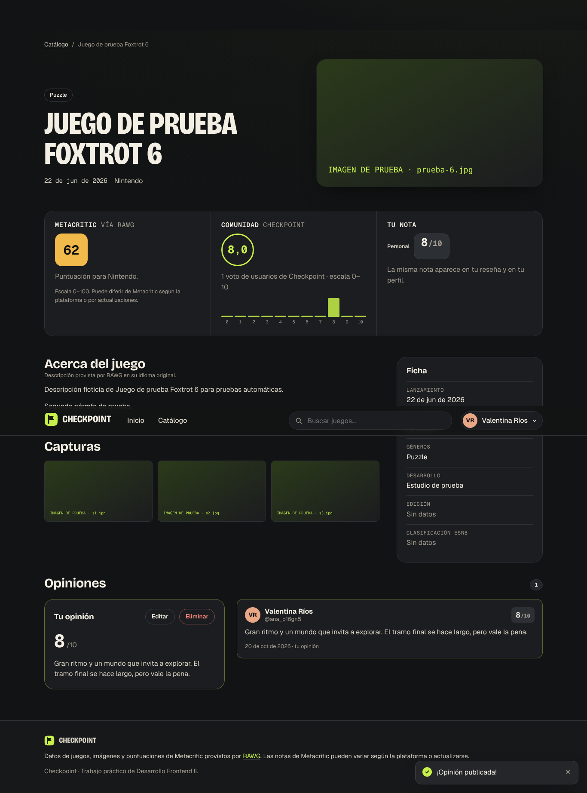 | 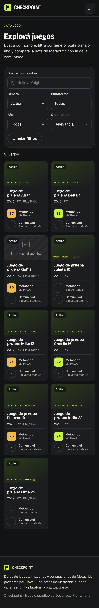 |

### Dificultades y soluciones
1. **Sin clave de RAWG ni proyecto de Firebase.** Se avanzó con todo lo verificable: la app muestra “pendiente de conexión” sin inventar datos; Firebase se probó con sus emuladores locales y RAWG con un doble de prueba solo dentro de las pruebas automáticas.
2. **Dos copias de `@firebase/app`.** `npm` instaló 0.16.2 (fijada por `firebase`) y 0.16.3 (pedida por otros paquetes). Las pruebas de reglas fallaban con `this.getApp(...).firestore is not a function`. Se diagnosticó con `npm ls @firebase/app` y se resolvió con `overrides` en `package.json` para usar una sola versión; el mismo problema habría roto Firestore en el navegador.
3. **`firebase@13` incompatible con `@firebase/rules-unit-testing`.** La herramienta de pruebas de reglas requiere `firebase@^12`, así que se fijó la versión 12.
4. **Filtro que “reaparecía”.** Una prueba detectó que, al elegir un filtro justo después de “Limpiar filtros”, volvía el filtro anterior: React Router procesa la navegación como transición y el manejador usaba parámetros de un render previo. Se corrigió calculando los parámetros desde `window.location` al momento del evento.
5. **Advertencias de lint de React** (`set-state-in-effect`, `only-export-components`): se movieron utilidades a `lib/` y el estado derivado se calcula durante el render en lugar de sincronizarlo con efectos.

### Uso de IA
Se trabajó con Claude Code (asistente de programación) sobre el repositorio. Instrucciones representativas:
- “Usá RAWG como fuente… protegé la clave en una función de servidor compatible con Vercel; limitá sus rutas y parámetros; evitá convertirla en un proxy abierto.”
- “Mostrá Metacritic · vía RAWG y Comunidad Checkpoint… No inventes puntuaciones, usuarios, reseñas ni cantidades de votos.”
- “Si faltan la clave de RAWG o la configuración de Firebase… no presentes datos ficticios ni almacenamiento local como servicios reales.”

El código generado se verificó con lint, build y las pruebas anteriores antes de cada commit.

---

## Iteración 2 — Mejora de funciones: perfiles y biblioteca

**Fecha:** 20/10/2026 · **Commits:** `fe9727a` (avance visible) y el cierre de la iteración 2.

### Cambios
- **Biblioteca personal** (`libraries/{uid}/games/{gameId}`): agregar desde la ficha con estado *Quiero jugar*, *Jugando*, *Completado* o *Abandonado*; cambiar estado; fecha de finalización opcional (solo para completados, sin fechas futuras); quitar; favoritos.
- **Destacados:** hasta 4 favoritos destacados en el perfil (`users.featured`). Quitar un juego o desmarcar el favorito lo saca de destacados en la misma escritura (`writeBatch`).
- **Perfil público** `/u/<alias>`: portada, avatar, nombre, alias, biografía, botón “Compartir perfil” (copia el enlace o usa el menú de compartir del celular), estadísticas reales (completados, reseñas, promedio de sus notas, juegos en biblioteca), destacados, grilla con filtros por estado y pestaña de reseñas.
- **Tres puntuaciones diferenciadas:** Metacritic (cuadrado 0–100), Comunidad (círculo 0–10 con votos) y nota personal (etiqueta “x/10” o “Sin puntuar”).
- **Fuente única de la nota personal:** la biblioteca no guarda puntuación; la grilla del perfil, los destacados y la ficha leen la reseña del usuario. Marcar “Completado” no crea una puntuación (las reglas incluso rechazan un campo `score` en la biblioteca).
- **Editar perfil:** nombre, alias (con liberación del alias anterior), biografía de 160 caracteres, avatar y portada, con vista previa.
- **Imágenes sin facturación:** Firebase Storage requiere el plan Blaze, así que no se usó. El avatar se recorta y comprime en el navegador a 192 px (data URL de hasta 80 000 caracteres, validada por las reglas) y la portada se elige entre imágenes de RAWG (de la biblioteca o de una búsqueda).
- **Actualización optimista** en estado y favoritos: la interfaz responde al instante y se revierte si Firestore rechaza el cambio.

### Pruebas realizadas
| Prueba | Resultado |
| --- | --- |
| `npm run lint` / `npm run build` | Sin advertencias / correcto |
| `npm test` (proxy de RAWG) | 15/15 |
| `npm run test:rules` — se agregaron perfil personalizable (bio, avatar, portada, ≤ 4 destacados) y biblioteca (solo el dueño escribe, estados válidos, fecha coherente, sin puntuación) | 22/22 |
| `npm run test:e2e` — se agregaron: estados + fecha + favoritos + destacados + nota sincronizada entre ficha, reseña y perfil; máximo de 4 destacados; edición de perfil con avatar subido y portada; enlace copiado; correo ausente del perfil público; visitante sin controles; perfil en celular sin desbordes | 15/15 |

### Evidencias
| Perfil (computadora) | Perfil (celular) | Editar perfil |
| --- | --- | --- |
| 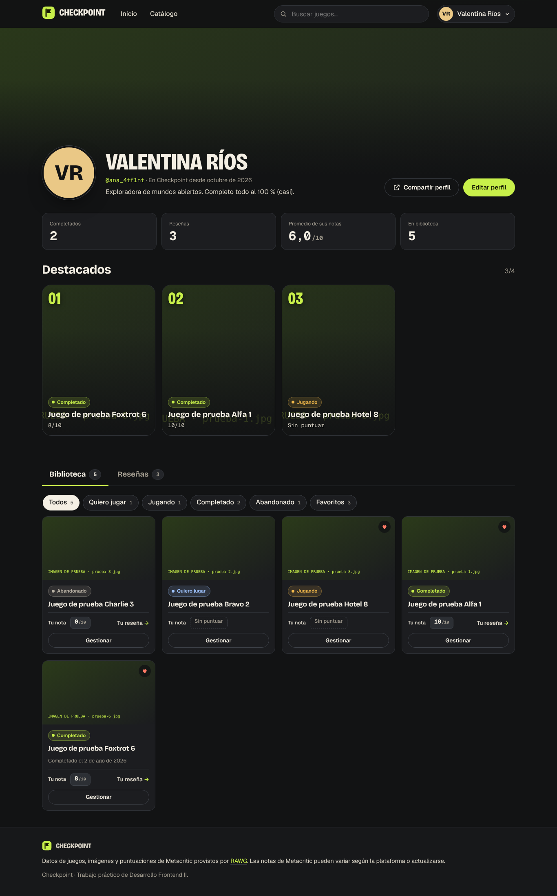 |  | 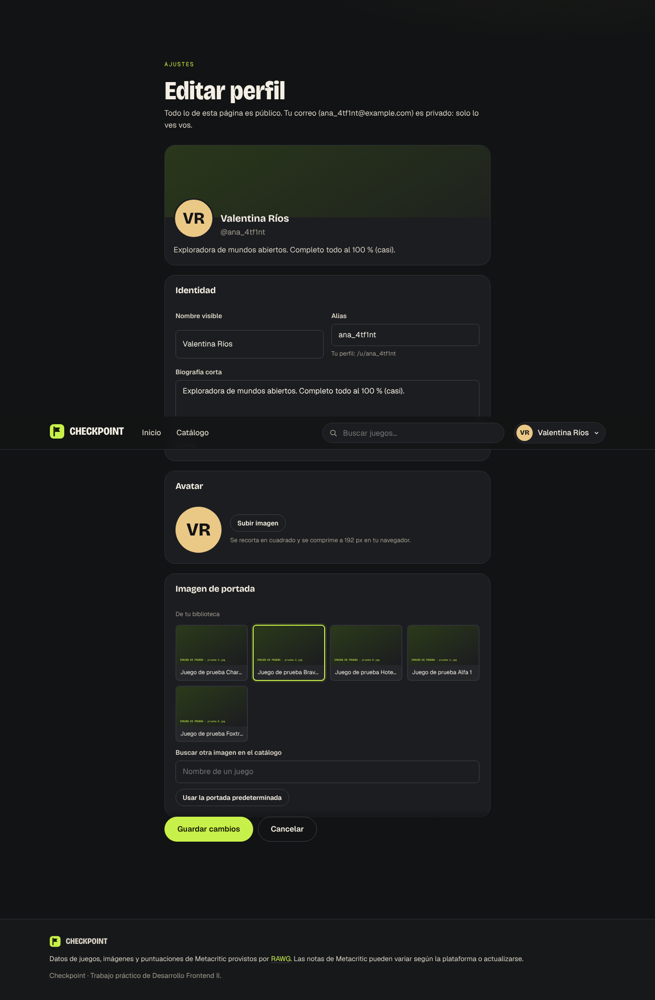 |

| Ficha con biblioteca (celular) |
| --- |
|  |

### Dificultades y soluciones
1. **Radio “controlado” que no cambiaba.** La prueba de biblioteca falló con “Clicking the checkbox did not change its state”: el estado marcado dependía de la respuesta de Firestore. Se agregó actualización optimista en la caché de React Query con reversión ante error.
2. **Formato de fechas.** La prueba esperaba “14 mar 2026”, pero `Intl` en `es-AR` produce “14 de mar de 2026”. Se ajustó la prueba al formato real.
3. **Revisión visual de las capturas:** en celular las tarjetas de biblioteca ocupaban una columna enorme (se pasó a dos columnas); en “Editar perfil”, el campo Alias quedaba desalineado por su texto de ayuda (`align-content: start`); en la ficha en celular, la biblioteca quedaba debajo de las capturas (se subió junto a las puntuaciones).
4. **Avatar sin Storage.** Se descartó Firebase Storage por requerir facturación y se optó por compresión en el navegador con límite validado en las reglas.

### Uso de IA
Instrucción representativa: “Diferenciá claramente la puntuación personal de la nota de Metacritic y del promedio de la comunidad… Marcar un juego como completado no debe crear una puntuación automáticamente… Evitá duplicar opiniones o generar valores contradictorios.” A partir de esto se decidió no guardar la nota en la biblioteca y derivarla siempre de la reseña.

---

## Iteración 3 — Versión final con refinamiento visual

**Fecha:** 20/10/2026 · **Commits:** `65d2ce3` (avance) y el cierre de la iteración 3.

### Cambios (a partir de la revisión de las capturas renderizadas)
- **Ficha:** la opinión propia aparecía dos veces (tarjeta “Tu opinión” y lista); ahora la lista muestra solo las demás, con un estado vacío propio (“Por ahora, la única opinión es la tuya”). El panel “Tu nota” se rediseñó con una caja de contorno blanco, distinta del cuadrado de Metacritic y del círculo de la comunidad. Se acortó el texto de votos que se cortaba en “escala 0–10”.
- **Inicio:** en celular los carriles pasan a deslizarse en horizontal (con ajuste por tarjeta) en lugar de apilar 24 tarjetas. Si no hay un juego destacado (por ejemplo, sin clave de RAWG), se muestra una presentación de marca con la leyenda de las tres puntuaciones, sin datos inventados.
- **Registro e ingreso en celular:** se conserva una franja con la frase de marca en lugar de ocultar todo el panel visual.
- **Estados “sin conectar”:** se quitó la redundancia “Pendiente · …pendiente de conexión” y la ficha ofrece volver al inicio.
- **Rendimiento:** páginas con carga diferida y bloques separados para React, Firebase y Firestore; desapareció la advertencia de paquetes > 500 kB (el bloque principal pasó de 1 012 kB a 44 kB + bibliotecas cacheables). Barra de progreso mientras se descarga una página.
- **Accesibilidad:** título de pestaña por página, pestañas del perfil con flechas del teclado y `tabIndex` según el patrón ARIA, y auditoría automática con axe (WCAG 2.1 AA, incluye contraste).

### Pruebas realizadas
| Prueba | Resultado |
| --- | --- |
| `npm run lint` / `npm run build` | Sin advertencias / correcto, sin avisos de tamaño |
| `npm test` (proxy de RAWG) | 15/15 |
| `npm run test:rules` | 22/22 |
| `npm run test:e2e` (incluye auditoría axe de inicio, catálogo, ficha, ingreso, registro y perfil) | 16/16 |
| Función `api/rawg.js` ejecutada con `Request` reales: sin clave → 503 `missing_key`; recurso no permitido → 404; clave inválida contra RAWG real → 502 `bad_key` | Correcto |

### Evidencias
| Inicio sin conexión (lo que se ve sin `.env`) | Ficha final | Registro en celular |
| --- | --- | --- |
|  | 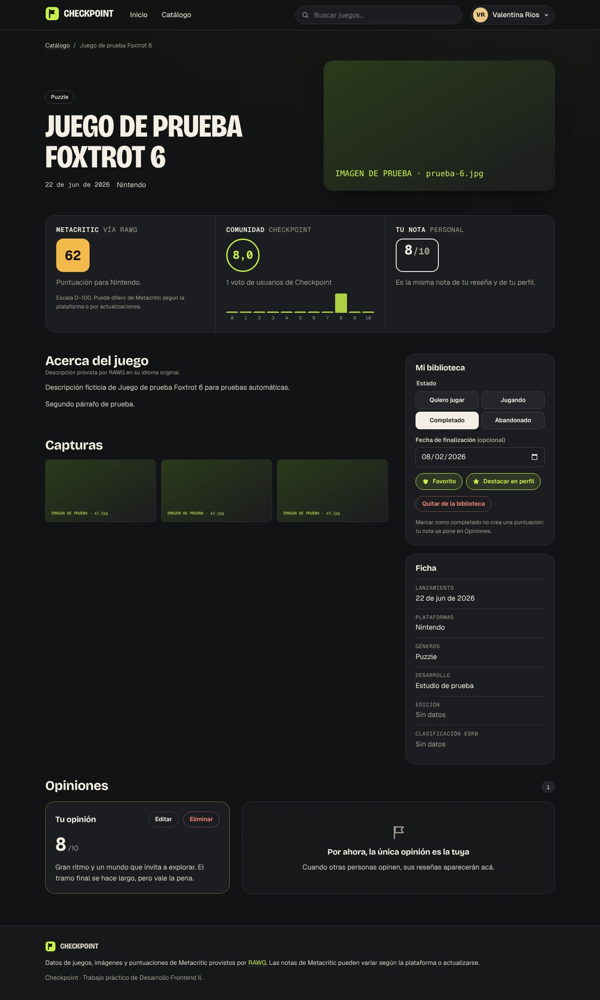 | 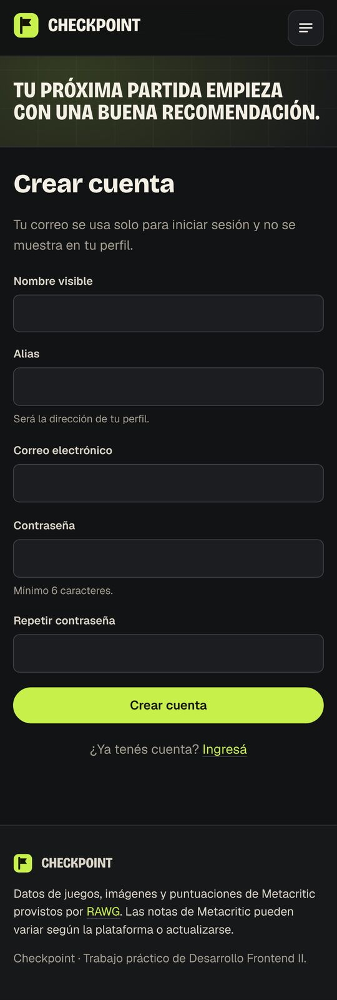 |

| Inicio en celular | Perfil final | Perfil en celular |
| --- | --- | --- |
| 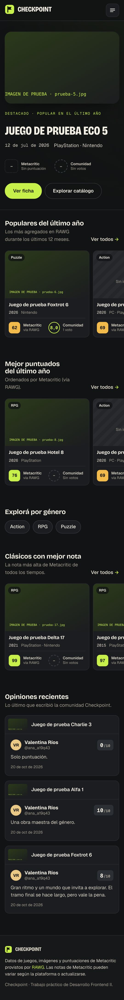 | 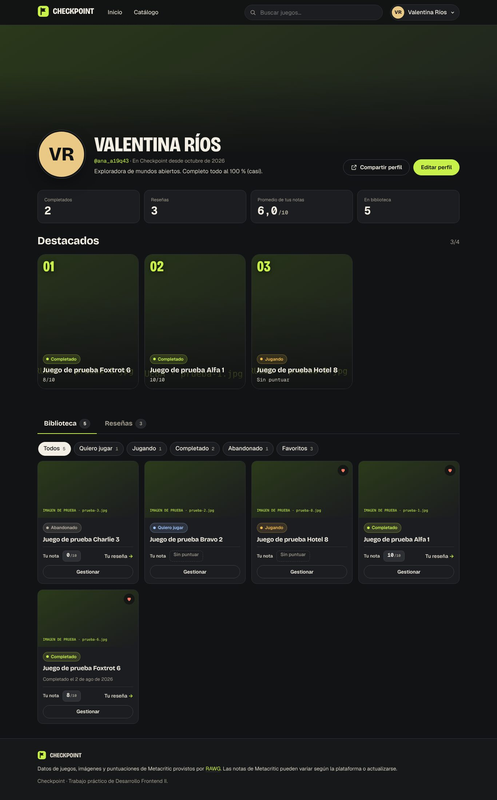 | 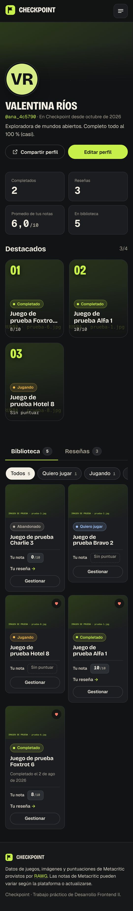 |

### Dificultades y soluciones
1. **Carga diferida y pruebas.** Al dividir el código, una prueba hizo clic en una tarjeta del inicio mientras se descargaba el catálogo, porque la página anterior seguía visible. Se agregó una barra de progreso de navegación (`useNavigation`) y la prueba ahora espera la nueva página.
2. **Capturas con imágenes vacías.** Las capturas de página completa no disparaban la carga diferida (`loading="lazy"`); el script ahora recorre la página antes de capturar.
3. **Peso de las evidencias.** Las capturas PNG de celular superaban los 10 000 px de alto; desde esta iteración se guardan como JPEG reducidas.

### Justificación del diseño final
- **Grafito + blanco cálido** dan un fondo calmo para que las imágenes de los juegos sean protagonistas; el **lima** se reserva para acciones principales, foco visible y notas altas, para que no compita con las portadas.
- **Bricolage Grotesque condensada en mayúsculas** para títulos (carácter “de caja de juego”), **Geist** para lectura y **Geist Mono** para números, lo que hace que las notas se alineen y se comparen fácilmente.
- **Una forma por tipo de nota** (cuadrado sólido = Metacritic 0–100, círculo = comunidad 0–10, caja de contorno = nota personal) para que se distingan aun sin leer la etiqueta; el color (lima/ámbar/coral) refuerza el rango, pero siempre hay texto.
- **Estados honestos:** cuando falta un servicio se dice qué falta y no se rellena con datos de ejemplo.

### Verificación con datos reales de RAWG
Con la clave de RAWG configurada en el `.env` local (fuera del repositorio), se probó el proxy y la interfaz contra la API real:

| Prueba | Resultado |
| --- | --- |
| Géneros, plataformas, búsqueda (“hollow knight” → 2 954 resultados), filtros combinados (RPG + Nintendo + 2017 → 95), orden por Metacritic, ficha de GTA V (92 general; PC 96, PS3 97, PS4 97, PS5 81…) y capturas | Correcto |
| Recurso no permitido (`resource=users`) | 404 |
| La clave aparece en alguna respuesta / la nota de usuarios de RAWG aparece | No / No |
| En el navegador: escribir “celeste” letra por letra genera **una sola** consulta; Platformer → +Nintendo → +2017 → orden Metacritic (18 juegos: Super Mario Odyssey, SteamWorld Dig 2, Hollow Knight…); “Cargar más” 20 → 40; ficha con 6 capturas y título de pestaña | Correcto |

Problemas que solo aparecieron con datos reales y se corrigieron:
1. **Imágenes en 404.** RAWG solo acepta algunos anchos de redimensión (420, 640, 1280, 1920…); 960 devolvía 404 y la ficha mostraba “Sin imagen”. Se ajusta al ancho permitido más cercano y, si la versión redimensionada falla, se usa la original antes de mostrar el estado vacío (prueba unitaria agregada).
2. **Carril vacío.** RAWG casi no tiene notas de Metacritic posteriores a 2023, así que “Mejor puntuados del último año” quedaba vacío; pasó a “Mejor puntuados de la última década”. En el catálogo, si se ordena por Metacritic y no hay resultados, se explica esta limitación.
3. **Destacado sin nota.** El inicio ahora prefiere un juego con imagen y nota de Metacritic.
4. **Textos cortados** (“Sin puntua…”, “Pendiente …”, “Puntuación M…”): etiquetas más cortas (“Sin nota”, “Sin conexión”, “Nota Metacritic”) y columna de orden más ancha. La ficha rotula “Nota general · por plataforma” cuando hay varias.

| Inicio con RAWG real | Catálogo (RPG por Metacritic) | Ficha con notas por plataforma | Inicio en celular |
| --- | --- | --- | --- |
| 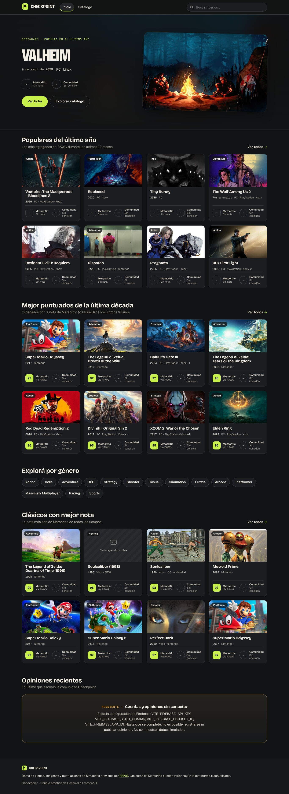 | 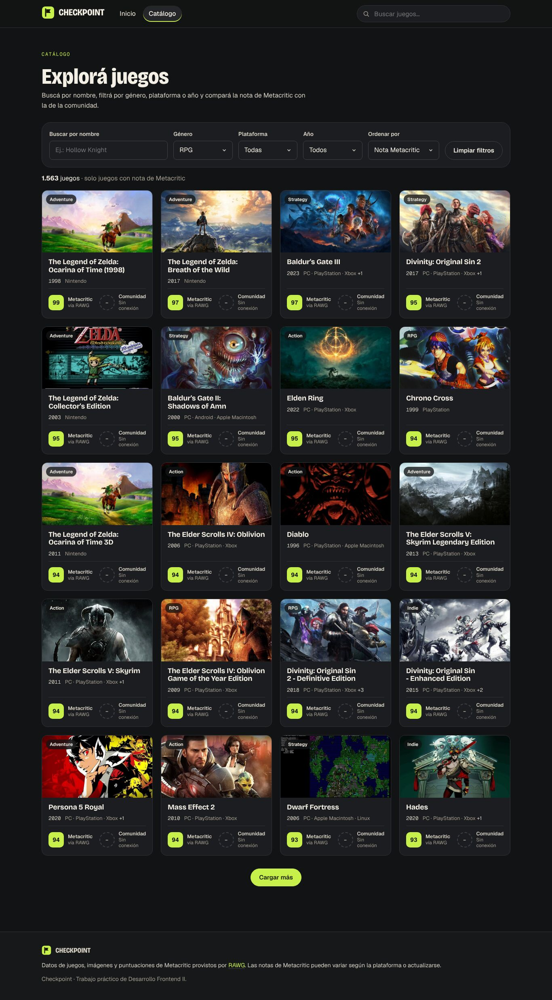 | 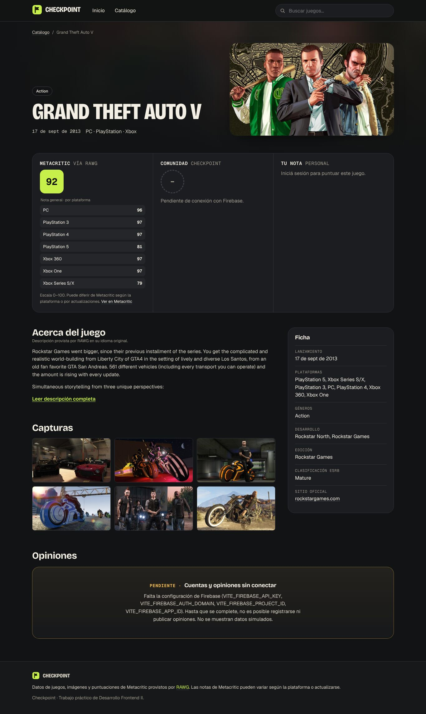 | 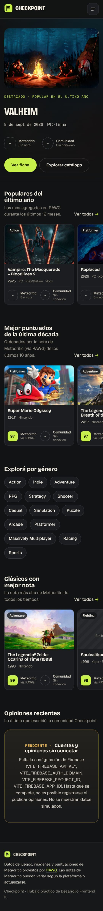 |

Imágenes, títulos y notas de Metacritic de estas capturas: datos de [RAWG](https://rawg.io).

---

## Configuración pendiente (al cierre de la iteración 3)
- **Firebase:** crear el proyecto, habilitar *Correo electrónico/contraseña*, crear Firestore y publicar `firestore.rules`; cargar las cuatro variables `VITE_FIREBASE_*`.
- **RAWG:** la clave ya funciona en desarrollo local (`.env`, no versionado); falta cargarla como `RAWG_API_KEY` en Vercel.
- **Vercel:** importar el repositorio con Root Directory `my-react-app`, cargar las variables y desplegar (requiere autorización del responsable). Luego agregar el dominio de Vercel en *Authentication → Dominios autorizados* y repetir las pruebas sobre la URL publicada (agregar, consultar, modificar, eliminar, recargar y celular).
- Hasta entonces, **ninguna prueba se hizo contra el proyecto real de Firebase**: cuentas, opiniones y biblioteca se verificaron con los emuladores. RAWG sí se verificó con datos reales (ver arriba).
