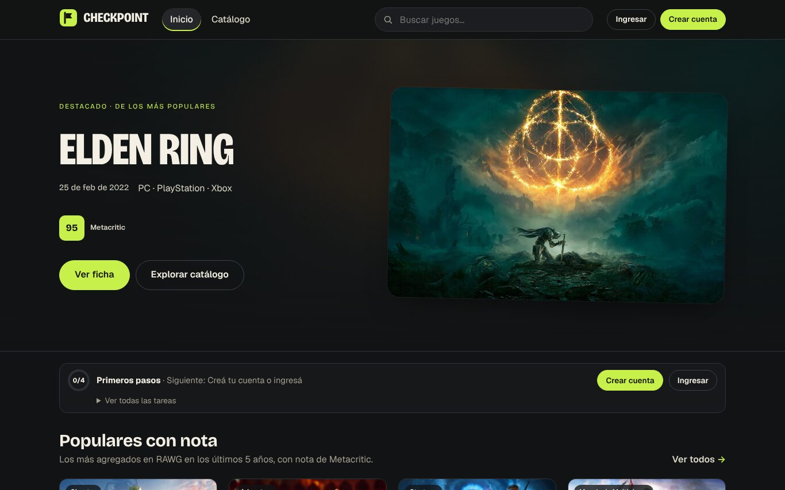

# Informe · Checkpoint

**TP2 · Desarrollo Frontend II** — Aplicación en React con IA, Firebase y despliegue en Vercel

| | |
| --- | --- |
| Integrante | Santiago Alvarez Granato · L.U. 1209881 |
| Aplicación publicada | https://app-theta-ten-t7mx3z64op.vercel.app/ |
| Repositorio | https://github.com/ssntyalvarez/App |
| Bitácora del proceso | [docs/BITACORA.md](BITACORA.md) |

## 1. Idea y público

**Checkpoint** es una red social para jugadores, inspirada en Metacritic y Steam. Sirve para **descubrir videojuegos, comparar la crítica con la opinión de la comunidad y llevar un registro propio** de lo que uno juega.

- **Necesidad que resuelve:** antes de comprar o jugar algo, mucha gente mira la nota de la crítica, pero esa nota no siempre coincide con la de los jugadores. Checkpoint muestra las dos por separado y suma las horas que cada persona jugó, para dar contexto a cada opinión.
- **Público:** jugadores que buscan recomendaciones, que quieren una página personal para mostrar sus gustos (favoritos y reseñas) y que quieren encontrar a otras personas con gustos parecidos.
- **La vuelta de tuerca:** además de guardar opiniones, la app tiene identidad social (seguir, amigos, chat), una progresión de niveles por opinar y un tutorial de primeros pasos.

## 2. Funciones implementadas

| Área | Funciones |
| --- | --- |
| Catálogo | Más de 500.000 juegos de RAWG: búsqueda, filtros (género, plataforma, año o década), orden, “Cargar más” y ficha con descripción, capturas, plataformas y lanzamiento. |
| Puntuaciones | Metacritic vía RAWG (0–100, por plataforma), promedio de la Comunidad Checkpoint (0–10, con votos y distribución) y nota personal. |
| Cuentas | Registro, ingreso y cierre de sesión con Firebase Authentication; alias único estilo Instagram; tutorial de primeros pasos. |
| Opiniones | Crear, editar y eliminar una opinión por juego: horas jugadas, nota de 0 a 10 y reseña. Persisten al recargar. |
| Perfil | Página pública `/u/alias` con foto, biografía, nivel, seguidores, seguidos, favoritos destacados, biblioteca y reseñas. |
| Biblioteca | Juegos favoritos, con hasta 4 destacados en el perfil. |
| Social | Seguir (si es mutuo, son amigos), sugerencias de amigos de amigos, buscador de personas y chat 1 a 1 en tiempo real en ventanas flotantes. |
| Configuración | Perfil, Privacidad (quién puede escribirte; mostrar seguidores y horas) y Cuenta (correo privado y cambio de contraseña). |
| Niveles | XP por cada juego opinado; anillo de color por nivel, al estilo Steam. |
| Experiencia de uso | Validaciones, estados de carga y de error, avisos de éxito, diseño para computadora y celular, navegación por teclado y auditoría de accesibilidad. |

## 3. Información guardada en Firebase

Se usan **Firebase Authentication** (correo y contraseña) y **Cloud Firestore**. Las contraseñas las maneja Google, y el correo nunca se guarda en Firestore.

| Colección | Qué guarda | Quién puede escribir |
| --- | --- | --- |
| `users/{uid}` | Perfil público: nombre, alias, bio, avatar, destacados y configuración de privacidad | Solo el dueño |
| `handles/{alias}` | A qué cuenta pertenece cada alias (garantiza que sean únicos) | Solo el dueño |
| `reviews/{juego}_{uid}` | Opinión: horas jugadas, nota 0–10, reseña y datos básicos del juego | Solo el autor |
| `libraries/{uid}/games/{juego}` | Juegos favoritos | Solo el dueño |
| `follows/{seguidor}_{seguido}` | Quién sigue a quién | Solo el seguidor |
| `chats/{a}_{b}/messages` | Conversaciones 1 a 1 | Solo sus dos integrantes (también para leer) |

**Reglas de seguridad** (`my-react-app/firestore.rules`): todo lo público se puede leer, pero cada persona solo modifica lo suyo. Las reglas validan tipos, rangos y campos permitidos: nota entera de 0 a 10, reseña de 10 a 2000 caracteres, sin campos de correo y alias con formato válido. También exigen esperar una semana entre cambios de alias y respetan la configuración “quién puede escribirme” del chat. Hay **32 pruebas automáticas** de las reglas en el emulador de Firestore.

## 4. Dónde se conecta Firebase y cómo se guardan los datos (para la demostración)

- **Configuración:** `my-react-app/src/lib/firebase.js` lee las variables `VITE_FIREBASE_*` con `import.meta.env` e inicializa `auth` y `db`. En Vercel, las variables se cargan en *Settings → Environment Variables*.
- **Sesión:** `src/context/AuthContext.jsx` (registro, ingreso, cierre y perfil en tiempo real con `onSnapshot`).
- **Consultar:** `listGameReviews` y `getCommunityStats` en `src/lib/reviews.js`; `listLibrary` en `src/lib/library.js`; `getConnections` en `src/lib/social.js`.
- **Agregar:** `saveReview` (`setDoc`), `addToLibrary`, `follow` y `sendMessage`.
- **Modificar:** `saveReview` sobre una reseña existente (`updateDoc`), `updateProfile` y `setFeatured`.
- **Eliminar:** `deleteReview`, `removeFromLibrary` y `unfollow`.

**Recorrido sugerido para la demostración:** crear una cuenta → opinar sobre un juego → mostrar el documento en Firestore → Datos → editar la nota → recargar la página → eliminar la opinión y ver que desaparece de la base.

## 5. Herramientas de IA utilizadas

- **Claude Code** (Anthropic): asistente de programación que trabajó sobre el repositorio. Generó el código, ejecutó lint, build y pruebas, sacó capturas de la interfaz para revisarla y subió los cambios con pull requests.
- **rembg** (modelo de segmentación `isnet-general-use`): recorte del fondo de las imágenes de personajes.

**Ejemplos representativos de instrucciones:**
1. “Quiero desarrollar una aplicación web de videojuegos llamada provisionalmente Checkpoint, inspirada en la función de Metacritic: descubrir juegos, consultar sus puntuaciones y permitir que cada usuario puntúe y deje su opinión.”
2. “Protegé la clave de RAWG en una función de servidor compatible con Vercel. Limitá sus rutas y parámetros; evitá convertirla en un proxy abierto.”
3. “No inventes puntuaciones, usuarios, reseñas ni cantidades de votos.”
4. “Si hacés una opinión… como hace Steam: aclarar el tiempo de juego, una puntuación y una descripción.”
5. “Que haya una progresión de niveles o XP para subir de nivel según cuántos juegos opinás.”
6. “Jerarquía no clara, hay mucho ruido… no TODO se resuelve con cards… mirá cómo lo resuelven Twitter, Twitch, Instagram, que es MUY LIMPIO.”

**Elaboración propia a partir del trabajo con IA:** la idea, el alcance y las decisiones de diseño fueron del autor. La interfaz no quedó en la primera propuesta de la IA: pasó por cinco versiones, y cada una se revisó en la versión publicada. Así se quitaron elementos genéricos (tarjetas, píldoras, tipografía monoespaciada), se reordenó la jerarquía del perfil y se cambió el modelo de la biblioteca. El detalle, con capturas de antes y después, está en la [bitácora](BITACORA.md).

## 6. Dificultades técnicas y cómo se resolvieron

Cada caso indica el síntoma o error observado, la causa encontrada y la solución aplicada en el código.

| Síntoma o error | Causa técnica | Solución |
| --- | --- | --- |
| Pruebas de reglas: `TypeError: this.getApp(...).firestore is not a function` | `npm ls @firebase/app` mostró dos copias (0.16.2 y 0.16.3): `@firebase/rules-unit-testing` registraba Firestore en una instancia de `FirebaseApp` distinta. | `firebase` fijado en `^12` (versión que exige `rules-unit-testing`) y `overrides` de `@firebase/app` en `package.json` para deduplicar el paquete. |
| En Firebase real: `FAILED_PRECONDITION: The query requires an index` (en el emulador funcionaba) | La agregación `average('score')` con `where('gameId', '==', …)` necesita un índice compuesto, y el emulador no valida índices. | Índice declarado en `firestore.indexes.json` y alternativa en `getCommunityStats` (`src/lib/reviews.js`): si la agregación falla, calcula el promedio con `statsFromReviews(listGameReviews())`. |
| Con RAWG caído (Cloudflare 522) la ficha quedaba cargando sin fin | `fetch` en el servidor no tiene tiempo límite, y React Query reintentaba una solicitud que nunca respondía. | `AbortSignal.timeout(10000)` en `server/rawg.js`; ante el corte devuelve `504` con `code: 'upstream_timeout'`. En `main.jsx`, React Query no reintenta ese código y la interfaz muestra el error con botón “Reintentar”. |
| Imágenes de RAWG en 404 | El CDN de RAWG solo acepta ciertos anchos en `/media/resize/{w}/-/`; 960 no existe. | `rawgImage()` (`src/lib/format.js`) elige el menor ancho válido de `RAWG_WIDTHS = [420, 640, 1280, 1920]`; si aun así falla, `onError` en `GameImage` vuelve a la URL original. |
| Proteger `RAWG_API_KEY` sin abrir un proxy | Cualquier ruta del tipo `/api/rawg?url=…` permitiría usar la clave para cualquier consulta. | Función `GET` en `api/rawg.js` con lista blanca de recursos (`games`, `game`, `screenshots`, `genres`, `platforms`) y de parámetros, recorte de campos y `Cache-Control: s-maxage`. La clave solo se lee con `process.env` en el servidor. |
| Vercel desplegaba una función de más | Vercel publica como función cada archivo dentro de `api/`, incluido el módulo auxiliar `api/_lib/rawg.js`. | Lógica movida a `server/rawg.js`; `api/rawg.js` solo la importa. `vite.config.js` monta el mismo módulo como middleware en desarrollo. |
| El panel Social medía 68 px de alto en lugar de ocupar la pantalla | El `backdrop-filter` del encabezado crea un *containing block* para los descendientes con `position: fixed`, así que el panel se medía contra el header. | El panel y el chat se renderizan con `createPortal(…, document.body)`. Además, el panel solo se monta abierto: cerrado y fuera de pantalla ensanchaba la página en celular. |
| Al limpiar un filtro, el valor anterior reaparecía | Dentro de una transición de React Router, `useSearchParams` devolvía parámetros desactualizados al armar la nueva URL. | Los parámetros se construyen desde `window.location.search` en el momento del evento. |
| Tras registrarse no aparecía el tutorial | El estado se leía de `localStorage` antes de que `markTourPending` lo escribiera, y `useState` no se volvía a enterar. | Estado expuesto con `useSyncExternalStore` y un evento propio que se emite al escribir. |
| Seguidores en “…” solo en la versión publicada | La API de Firestore devolvía `PERMISSION_DENIED`: las reglas publicadas eran anteriores a `follows` y desplegar en Vercel no las actualiza. | Reglas publicadas con `firebase deploy --only firestore:rules`; la interfaz muestra “—” cuando la consulta falla. |
| Chat en la demostración: mensajes que no llegaban o error al enviar | Tres fallas en `Conversation.jsx` y `sendMessage`: (1) mientras un envío esperaba la confirmación del servidor, el siguiente salía por `if (sending) return` y `setText('')` borraba lo escrito; (2) si los dos escribían el primer mensaje a la vez, el segundo hacía `set` sobre un chat ya creado, y las reglas lo rechazan con `permission-denied` porque cambia `members` y `createdAt`; (3) el receptor solo escuchaba sus chats (`watchChats`) si ya tenía una ventana abierta, así que no se enteraba. | Envíos en cola con una cadena de promesas (`useRef(Promise.resolve())`), el cuadro se vacía al enviar y el texto vuelve si falla; ante `permission-denied` con el chat ya existente, `sendMessage` reintenta con `update`; `ChatDockProvider` escucha los chats durante toda la sesión y abre la ventana cuando llega un mensaje posterior a la carga. Prueba nueva `e2e/chat.spec.js` con dos navegadores, que falla con el código anterior. |
| El chat tapaba el menú de cuenta | `z-index` 55 del contenedor del chat, por encima del header (40). | Contenedor del chat en `z-index: 35`. |

## 7. Verificación

- **Pruebas automáticas:** 34 unitarias, 32 de reglas de Firestore y 26 de punta a punta en navegador, que incluyen celular y accesibilidad.
- **Contra los servicios reales:** catálogo de RAWG y proyecto real de Firebase (crear, editar, eliminar, recargar, y comprobar que otra cuenta no puede modificar datos ajenos).
- **Publicación:** cada cambio se fusiona en `main` por pull request, y Vercel lo despliega automáticamente.
